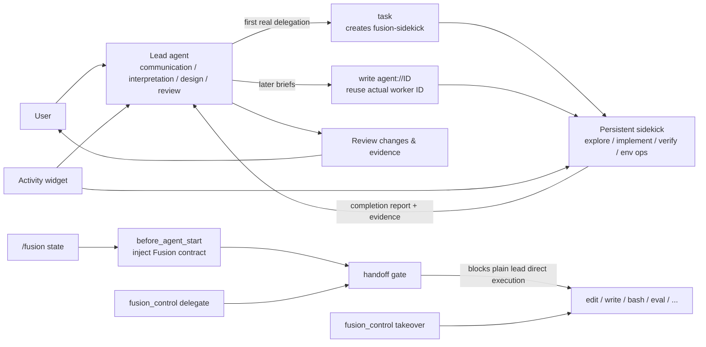

# omp-fusion

[中文文档](README.zh-CN.md)

A **Fusion lead/sidekick working mode** for [Oh My Pi (omp)](https://github.com/can1357/oh-my-pi): a lead agent owns user communication, requirement interpretation, key design decisions, and final review, while a persistent, reusable sidekick agent handles delegated code exploration, implementation, verification, and environment operations.

This plugin borrows the **Local Fusion** idea from Devin, but it is an independent implementation built on omp's extension mechanism — it does not depend on Devin services and is not an official Devin integration.

## When to use it

Fusion is a good fit for:

- Multi-round implementation: locate the problem, change code, then keep correcting based on results.
- Work that needs persistent context: the same sidekick keeps its own context and runtime across briefs.
- Tasks where codebase exploration and implementation can be split: the lead sets direction, the sidekick does routine execution.
- Delegating while doing independent lead work: the sidekick can run asynchronously; the lead only works in parallel when there is genuinely independent work.
- Automation with a clear authority boundary: routine execution goes to the sidekick; commits, pushes, PRs, production queries, and critical data interpretation stay with the lead.

Fusion is unnecessary for pure Q&A, one-off trivial operations that need no continued delegation, or interactive tasks the lead must perform end-to-end. Fusion grants no extra permissions and never commits, pushes, or opens PRs on your behalf.

## Quick start

### Install / load the plugin

```bash
pi install npm:omp-fusion
# or load the directory directly:
omp --extension /path/to/omp-fusion
```

The extension entry point is declared via `omp.extensions` / `pi.extensions` in `package.json`.

On the first `session_start`, the plugin installs the bundled `agents/fusion-sidekick.md` definition into your user agents directory (`~/.omp/agent/agents/`). This is required because npm-installed plugin `agents/` folders are not picked up by omp's task-agent discovery. The installed file carries a content-hash marker: it is refreshed on upgrades but never overwrites a file you have modified yourself.

### Enable Fusion

Inside an omp session, type:

```text
/fusion
```

Once enabled, Fusion records its state in the current session and routes subsequent hands-on requests to the persistent sidekick. Run `/fusion` again to turn it off.

You can also enable it and submit a first directive in one step:

```text
/fusion Fix the pagination boundary issue in the current module and run the minimal verification for that path
```

Other commands:

```text
/fusion status
/fusion lead <model[:level]>
```

- `/fusion status`: shows whether Fusion is on, lead/sidekick activity, and where to configure the sidekick model.
- `/fusion lead <model[:level]>`: switches the lead model for this session only; does not change the sidekick.
- `/fusion lead`: shows the current lead model.

The sidekick model is resolved through omp's `/agents` configuration. The bundled `fusion-sidekick` agent declares the `@smol` role by default, so you can swap the underlying model centrally via role mapping or an agent override.

For example, if your local model registry provides `devin/swe-2:high`:

```yaml
modelRoles:
  smol: devin/swe-2:high

task:
  agentModelOverrides:
    fusion-sidekick: devin/swe-2:high
```

Model IDs must be resolvable by your local omp configuration; the example above is the sidekick configuration used in this project's experiments and the Devin Fusion reference — it is not a hard-coded service dependency.

## Architecture



### Core components

| Component | File | Responsibility |
| --- | --- | --- |
| Extension entry | `fusion.js` | Registers `/fusion`, `fusion_control`, session events, and the handoff gate; injects the working contract into the lead. |
| Status bar | `fusion-status.js` | Listens to lead/sidekick lifecycle, message, tool, retry, and compaction events; renders the activity widget. |
| Sidekick agent | `agents/fusion-sidekick.md` | Defines the persistent worker's role boundaries, brief execution style, and report format. |
| Control tests | `tests/fusion-control.test.mjs` | Verifies toggling, state restoration, the handoff gate, takeover/delegate, and the prompt contract. |
| Delegation smoke | `tests/delegation-smoke.mjs` | Uses the real omp CLI to verify first-time worker creation, worker reuse on later requests, and normal execution after Fusion is off. |
| Ablation | `experiments/ablation.mjs` | Compares how briefs, async scheduling, and the handoff gate affect behavior and cost. |

### Lifecycle of one request

1. `/fusion` appends `omp.fusion.state` to the current session; the state is re-read across branch, tree, and switch navigation.
2. `before_agent_start` appends the Fusion contract to the lead system prompt based on state; it never fakes an "on" state when Fusion is off or unset.
3. The first real hands-on delegation creates `fusion-sidekick` through `task`, requests the name `Sidekick`, and stores the returned worker ID (which can differ from the requested name, e.g. `Sidekick-2`).
4. Later requests send new briefs to the same worker by writing to `agent://<ID>` instead of creating agents repeatedly; the lead then calls `wait` for the report. Messaging a parked sidekick revives it with its history.
5. The sidekick returns a completion report with evidence; the lead reviews the changes and verification before reporting to the user.
6. After the request ends, `takeover` is not carried into the next request; session navigation also clears it, so stale temporary authorization cannot leak forward.

## Lead vs. sidekick responsibilities

### The lead owns

- User communication, requirement interpretation, ambiguity handling, and overall planning.
- Correctness-critical design decisions, key data interpretation, and acceptance criteria.
- Reviewing the sidekick's changes and evidence; deciding whether to accept, correct, or take over.
- Production/shared-environment queries, complex interactive browser work, and authority actions such as commits, pushes, and PRs.
- Correctness-critical instructions that must be authored by the lead personally.

### The sidekick owns

- Exploring relevant code, implementing changes, and handling routine environment operations per the lead's brief.
- Running targeted verification directly related to the acceptance criteria.
- Pushing back with concrete evidence when code evidence conflicts with the brief, rather than guessing silently.
- Reporting changes, file paths, verification results, and blockers in the final report.

An effective brief contains: the goal, relevant code locations, key design decisions, constraints, edge cases, and observable acceptance criteria. Unless the algorithm or interface itself has already been decided by the lead, implementation details do not need to be spelled out.

## Handoff safety boundary

While Fusion is on and the current request has no takeover, the runtime blocks the lead from directly calling these execution paths:

- `edit`, `bash`, `eval`, `exec`, `python`, `apply_patch`, `ast_edit`, `debug`, `ssh` — including devices reached through `write xd://<device>`, which omp re-checks under the device's own name
- `write` to files and to any URL other than the coordination targets `agent://` (brief the sidekick), `out://`, `local://`, `xd://`, and `proc://<id>/kill`
- LSP operations that change code or configuration: `rename`, `rename_file`, `code_actions`, `request`

Reads, ordinary delegation, waiting on workers, and read-only LSP operations remain available. The gate's purpose is not privilege escalation — it makes "Fusion is on but the lead is secretly executing inline" observable and blockable.

When the lead must act personally, declare a concrete reason first:

```text
fusion_control({
  action: "takeover",
  reason: "Review the sidekick's completed production migration script and run the final shared query"
})
```

Then restore delegation when done:

```text
fusion_control({
  action: "delegate",
  reason: "Lead-only query finished; implementation continues with the sidekick"
})
```

`fusion_control` only records the current request's handoff decision — it grants no new permissions and does not stop a running worker. Blank reasons, cancelled calls, and control calls while Fusion is off are all rejected.

## The Devin Fusion model it references

This plugin borrows Devin Local Fusion's **collaboration shape**, not an external runtime:

| Devin Fusion idea | omp-fusion implementation |
| --- | --- |
| Lead / execution-worker split | `fusion.js` injects the lead contract; `fusion-sidekick.md` performs delegated execution |
| Worker keeps context across tasks | First use creates the sidekick via `task`; later briefs reuse the same worker ID via `write agent://<ID>` |
| Lead and worker can run in parallel | The task launch returns while the sidekick runs; the lead only parallelizes genuinely independent work, otherwise waits via `wait` |
| Worker reports execution evidence | The sidekick's final report must include changes, paths, verification results, and blockers |
| Clear responsibility boundary | The handoff gate blocks plain lead direct execution; lead-only scenarios use explicit `takeover` |
| Visible run state | `fusion-status.js` shows Lead and Sidekick models, phases, and tool status |

Unlike "let two agents collaborate randomly," Fusion's key constraint is: **the lead keeps judgment, the sidekick keeps execution continuity, and every handoff is traceable**. The sidekick may challenge a brief, but final design, review, and user commitments remain the lead's responsibility.

## Verification

This repository provides two kinds of verification:

```bash
# Control-logic unit tests
bun test tests/fusion-control.test.mjs

# Real omp CLI delegation smoke; requires omp installed and working model credentials
npm run smoke:delegation
```

`tests/delegation-smoke.mjs` verifies:

- Ordinary conversation does not create a sidekick for no reason.
- The first implementation request creates a real `fusion-sidekick`.
- Later requests reuse the worker ID returned the first time.
- With Fusion on, the lead does not directly execute ordinary implementation tools.
- After Fusion is turned off, inline execution resumes and no further delegation goes to the old sidekick.

## Design tradeoffs

- **Persistent worker over a fresh agent each time**: reduces context re-establishment and lets multi-round fixes share a runtime; the cost is that the lead must maintain the worker ID and brief boundaries correctly.
- **Async-first over blind parallelism**: parallel work is used only for genuinely independent lead work, avoiding duplicate investigation and racy edits.
- **Runtime gate over prompt-only convention**: the prompt provides collaboration rules while the tool-call gate blocks obvious boundary violations; the lead can still take over explicitly.
- **State in the session over memory only**: the on/off state survives branch and session navigation; temporary takeover is deliberately not persisted.

## Project structure

```text
omp-fusion/
├── fusion.js                    # Plugin entry, commands, contract, handoff gate
├── fusion-status.js             # Lead/Sidekick activity widget
├── agents/
│   └── fusion-sidekick.md       # Persistent sidekick definition
├── tests/
│   ├── fusion-control.test.mjs  # Control-logic tests
│   └── delegation-smoke.mjs     # Real CLI delegation smoke
├── experiments/
│   ├── ablation.mjs             # Ablation experiment runner
│   └── analyze.mjs              # Experiment result analysis
└── package.json                 # omp extension metadata
```

## Limitations

- The sidekick model must already be registered and resolvable in your omp environment; the plugin does not install or authorize models for you.
- The sidekick's working permissions remain bound by the current omp session, tools, and filesystem permissions.
- The handoff gate only covers the direct-execution entry points the plugin explicitly recognizes; it is not a security sandbox and does not replace review.
- `npm run smoke:delegation` is an opt-in integration smoke that uses your environment's omp CLI and model credentials; use the control-logic tests when those are unavailable.
- Requires omp 18.3.0 or later, where peer messaging moved from the removed `hub` tool to `write agent://<ID>` and `wait`.

## License

MIT
