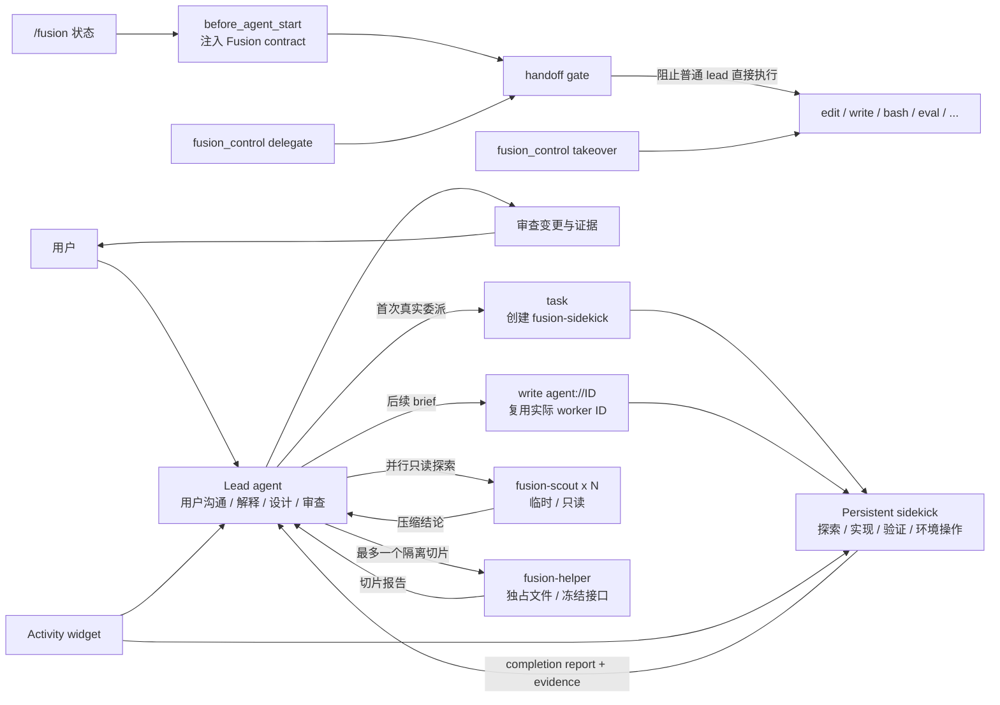

# omp-fusion

[English](README.md)

为 [Oh My Pi（omp）](https://github.com/can1357/oh-my-pi) 提供 **Fusion lead/sidekick 工作模式**：由一个 lead agent 负责用户沟通、目标解释、关键设计与最终审查；由一个可持续复用的 sidekick agent 承担委派的代码探索、实现、验证和环境操作。

本插件参考 Devin 的 **Local Fusion** 思路，但它是面向 omp 扩展机制的独立实现，不依赖 Devin 服务，也不代表与 Devin 存在官方集成关系。

## 适用场景

Fusion 适合以下任务：

- 多轮实现：先定位问题，再修改代码，随后根据结果继续修正。
- 需要持续上下文的工作：同一个 sidekick 在多个 brief 之间保留自己的上下文和运行时。
- 代码库探索与实现可以拆开的任务：lead 负责方向，sidekick 负责常规执行。
- 需要边委派边处理独立 lead 工作的任务：sidekick 可以异步运行，lead 只在有真实独立工作时并行推进。
- 需要明确权限边界的自动化：普通执行交给 sidekick；提交、推送、PR、生产查询、关键数据解释等权威动作留在 lead 侧。

以下情况不必开启 Fusion：纯问答、一次性很小且不需要连续委派的操作，或 lead 必须从头到尾亲自执行的交互式任务。Fusion 不会授予额外权限，也不会替 lead 自动执行提交、推送或 PR。

## 快速开始

### 加载插件

通过 omp 的 extension 机制加载本目录：

```bash
omp --extension /path/to/omp-fusion
```

也可以使用包元数据中的 extension 配置加载 `fusion.js`。插件入口由 `package.json` 的 `omp.extensions` / `pi.extensions` 声明。

首次 `session_start` 时，插件会把内置的 agent 定义（`agents/fusion-sidekick.md`、`agents/fusion-scout.md`、`agents/fusion-helper.md`）安装到用户 agents 目录（`~/.omp/agent/agents/`）。这是必须的，因为 omp 的 task agent 发现机制不会扫描 npm 安装插件内的 `agents/` 目录。每个安装的文件都带有各自的内容 hash 标记：插件升级时会自动刷新，但如果你手动修改过该文件则不会被覆盖。

### 开启 Fusion

在 omp 会话中输入：

```text
/fusion
```

开启后，Fusion 会在当前会话中记录状态，并将后续 hands-on 请求路由给持久 sidekick。再次执行 `/fusion` 可关闭。

也可以在开启的同时提交第一条指令：

```text
/fusion 修复当前模块的分页边界问题，并运行针对该路径的最小验证
```

其他命令：

```text
/fusion status
/fusion lead <model[:level]>
```

- `/fusion status`：查看 Fusion 是否开启、lead/sidekick 活动状态，并提示 sidekick 模型配置位置。
- `/fusion lead <model[:level]>`：仅切换当前会话的 lead 模型；不改变 sidekick。
- `/fusion lead`：显示当前 lead 模型。

sidekick 的模型通过 omp 的 `/agents` 配置解析。插件中的 `fusion-sidekick`、`fusion-scout`、`fusion-helper` 默认都声明使用 `@smol` 角色，因此可以集中通过角色映射替换底层模型，也可以用 `task.agentModelOverrides` 按 agent 单独覆盖。

例如，若本地模型注册表提供 `devin/swe-2:high`，可以使用类似配置：

```yaml
modelRoles:
  smol: devin/swe-2:high

task:
  agentModelOverrides:
    fusion-sidekick: devin/swe-2:high
```

模型 ID 必须以本地 omp 配置能够解析为准；上例是本项目实验和 Devin Fusion 参考中使用的 sidekick 配置，不是插件硬编码的服务依赖。

## 架构



### 核心组件

| 组件 | 文件 | 职责 |
| --- | --- | --- |
| Extension 入口 | `fusion.js` | 注册 `/fusion`、`fusion_control`、会话事件和 handoff 规则；向 lead 注入工作契约。 |
| 状态栏 | `fusion-status.js` | 监听 lead/sidekick 生命周期、消息、工具、重试和 compaction 事件，渲染活动状态。 |
| Sidekick agent | `agents/fusion-sidekick.md` | 定义持久 worker 的角色边界、集成职责、brief 执行方式和报告格式。 |
| Scout agent | `agents/fusion-scout.md` | 临时只读探索者（仅 `read`、`grep`、`glob`、`ast_grep`、`web_search`），返回带 file:line 证据的压缩结论。 |
| Helper agent | `agents/fusion-helper.md` | 临时写入者，只负责一个隔离切片；只改 brief 指定的文件，只跑 brief 指定的针对性检查。 |
| 控制测试 | `tests/fusion-control.test.mjs` | 验证切换、状态恢复、handoff gate、takeover/delegate 和 prompt contract。 |
| 委派冒烟 | `tests/delegation-smoke.mjs` | 使用真实 omp CLI 验证首次创建 worker、后续复用 worker、关闭 Fusion 后恢复普通执行。 |
| 消融实验 | `experiments/ablation.mjs` | 比较 brief、异步调度和 handoff gate 等因素对行为及成本的影响。 |

### 一次请求的生命周期

1. `/fusion` 将 `omp.fusion.state` 追加到当前 session；状态会随 branch、tree、switch 重新读取。
2. `before_agent_start` 根据状态向 lead system prompt 追加 Fusion contract；关闭或没有 Fusion 状态时不会伪造开启状态。
3. 第一次真实 hands-on 委派通过 `task` 创建 `fusion-sidekick`，请求名为 `Sidekick`，并保存返回的实际 worker ID（可能与请求名不同，例如 `Sidekick-2`）。
4. 后续请求通过写入 `agent://<ID>` 把新 brief 发给同一个 worker，而不是重复创建 agent；随后 lead 调用 `wait` 等待报告。向已 parked 的 sidekick 发消息会带着历史把它唤醒。
5. sidekick 返回完成报告和证据；lead 审查变更与验证结果，再向用户报告。
6. 请求结束后，`takeover` 不会自动跨请求继承；session 导航也会清除它，避免旧的临时授权泄漏到下一次请求。

## Lead 与 sidekick 的分工

### Lead 负责

- 用户沟通、需求解释、歧义处理和总体计划。
- 影响正确性的设计决策、关键数据解释和验收标准。设计权留在 lead：brief 明确本次变更允许引入哪些接口、抽象、配置和范围。
- 审查 sidekick 的变更与证据，并决定是否接受、修正或接管。
- 生产/共享环境查询、复杂交互式浏览器工作，以及 commit、push、PR 等 authority actions。
- 必须由 lead 作者亲自确定的 correctness-critical 指令。

### Sidekick 负责

- 按 lead brief 探索相关代码、实现修改和处理常规环境操作。
- 运行与验收标准直接相关的 targeted verification。
- 集成 helper 的切片，并在集成完成后统一跑一次全量验证（测试套件、linter、formatter）。
- 在代码证据与 brief 冲突时提出具体反驳，而不是静默猜测。新的抽象、配置项、公共 API、分层或范围只能作为提案回报，不能直接写进代码。
- 通过最终报告给出修改内容、文件路径、验证证据和阻塞点。

### 角色分层

| 角色 | Agent | 生命周期 | 写权限 | 验证职责 |
| --- | --- | --- | --- | --- |
| Sidekick | `fusion-sidekick` | 常驻，恰好一个 | 默认拥有所有写入 | 每个 brief 跑针对性检查；集成后跑一次全量验证 |
| Scout | `fusion-scout` | 临时，一次 task 批次可开多个 | 无（工具列表只读） | 无 |
| Helper | `fusion-helper` | 临时，同一时刻最多一个 | 仅 brief 分配的文件 | 仅 brief 指定的针对性检查 |

lead 只在一个切片同时满足以下三条时才开 helper：(a) 写入的文件没有其他 worker 会碰；(b) 只依赖 lead 在 brief 中冻结的接口；(c) 有独立的验收检查。任一条不满足，就串行交给 sidekick。scout 只用于"结论不出来就会拖慢 sidekick 或 lead 下一步决策"的独立区域，不去重复 sidekick 已负责的范围。

一个有效的 brief 按"可交付成果"拆分，而不是按"步骤"拆分：一个 brief 对应一个结果和它自己的可观察验收标准；解释成本与亲自完成成本相当的小块，留在当前 worker 的 brief 里。brief 应包含：目标、相关代码位置、关键设计决策、约束、边界情况和验收标准。除非算法或接口本身已经由 lead 决定，否则不必把每个实现细节写死。

## Handoff 安全边界

Fusion 开启且当前请求没有 takeover 时，运行时会阻止 lead 直接调用以下执行路径：

- `edit`、`bash`、`eval`、`exec`、`python`、`apply_patch`、`ast_edit`、`debug`、`ssh`，也包括通过 `write xd://<device>` 调用的设备（omp 会以设备本身的名字再次检查）
- 写入文件，或写入除协作目标 `agent://`（给 sidekick 发 brief）、`out://`、`local://`、`xd://`、`proc://<id>/kill` 之外任何 URL 的 `write`
- 会改变代码或配置的 LSP 操作：`rename`、`rename_file`、`code_actions`、`request`

读取、普通委派、等待 worker 和只读 LSP 操作仍然可用。这个 gate 的目的不是权限升级，而是让“已开启 Fusion 却偷偷由 lead 内联执行”的路径变得可观察且可阻断。

需要 lead 亲自处理时，先声明具体原因：

```text
fusion_control({
  action: "takeover",
  reason: "审查 sidekick 已完成的生产迁移脚本并执行最终共享查询"
})
```

完成后恢复委派：

```text
fusion_control({
  action: "delegate",
  reason: "lead-only 查询已完成，后续实现继续交给 sidekick"
})
```

`fusion_control` 只记录当前请求的 handoff 决策，不授予新权限，也不会停止正在运行的 worker。空白 reason、已取消调用和 Fusion 关闭时的控制调用都会被拒绝。

## 参考的 Devin Fusion 模型

本插件借鉴的是 Devin Local Fusion 的**协作形态**，而不是复制一个外部运行时：

| Devin Fusion 思路 | omp-fusion 对应实现 |
| --- | --- |
| lead 与执行 worker 分工 | `fusion.js` 注入 lead contract，`fusion-sidekick.md` 承担 delegated execution |
| worker 跨任务保持上下文 | 首次使用 `task` 创建 sidekick，后续通过同一 worker ID 的 `write agent://<ID>` 发送 brief |
| lead 与 worker 可以并行 | task launch 在 sidekick 运行时即返回；lead 仅在存在真实独立工作时并行，否则通过 `wait` 等待 |
| worker 回传执行证据 | sidekick final report 要求提供变更、路径、验证结果和阻塞点 |
| 清晰的职责边界 | handoff gate 阻止普通 lead 直接执行；lead-only 场景显式 `takeover` |
| 可见的运行状态 | `fusion-status.js` 展示 Lead 与 Sidekick 的模型、阶段和工具状态 |

与“让两个 agent 随机协作”不同，Fusion 的关键约束是：**lead 保留判断权，sidekick 保留执行连续性，handoff 必须可追踪**。sidekick 可以质疑 brief，但最终设计、审查和用户承诺仍由 lead 负责。

## 验证

本仓库提供两类验证：

```bash
# 控制逻辑单元测试
bun test tests/fusion-control.test.mjs

# 真实 omp CLI 委派冒烟；需要已安装 omp 和可用模型凭据
npm run smoke:delegation
```

`tests/delegation-smoke.mjs` 会验证：

- 普通对话不会无故创建 sidekick。
- 第一次实现请求创建一个真实 `fusion-sidekick`。
- 后续请求复用第一次返回的 worker ID。
- Fusion 开启时 lead 不直接执行普通实现工具。
- 关闭 Fusion 后恢复 inline execution，且不会继续向旧 sidekick 委派。

## 设计取舍

- **持久 worker，而非每次新建 agent**：减少上下文重新建立，让多轮修正共享运行时；代价是 lead 必须正确维护 worker ID 和 brief 边界。
- **异步优先，而非盲目并行**：并行只用于真正独立的 lead 工作，避免重复调查和竞态修改。
- **角色分层，而非 N 个对等 sidekick**：每多一个写入者，就多一份重复探索、重复跑测试、设计漂移，以及合并和审查负担。由一个常驻 sidekick 拥有写入和全量验证；只读 scout 低成本并行探索；单个 helper 只留给在文件、接口和验收上都隔离的切片。
- **设计权归 lead**：worker 只在 brief 规定的接口和范围内实现，超出部分以提案形式回报，避免并行或连续 brief 累积未经要求的抽象。
- **运行时 gate，而非仅 prompt 约定**：prompt 提供协作规则，tool-call gate 负责阻止明显越界；lead 仍可用显式 takeover 接管。
- **状态写入 session，而非只保存在内存**：branch 和 session navigation 后能够恢复开关状态；临时 takeover 则刻意不持久化。

## 项目结构

```text
omp-fusion/
├── fusion.js                    # 插件入口、命令、contract、handoff gate
├── fusion-status.js             # Lead/Sidekick 活动状态 widget
├── agents/
│   ├── fusion-sidekick.md       # 持久 sidekick 定义
│   ├── fusion-scout.md          # 只读 scout 定义
│   └── fusion-helper.md         # 隔离切片 helper 定义
├── tests/
│   ├── fusion-control.test.mjs  # 控制逻辑测试
│   └── delegation-smoke.mjs     # 真实 CLI 委派冒烟
├── experiments/
│   ├── ablation.mjs             # 消融实验运行器
│   └── analyze.mjs              # 实验结果分析
└── package.json                 # omp extension 元数据
```

## 限制

- sidekick 模型必须已在当前 omp 环境注册并可解析；插件不会替用户安装或授权模型。
- sidekick 的工作权限仍受 omp 当前会话、工具和文件系统权限约束。
- handoff gate 只覆盖插件显式识别的直接执行入口；它不是安全沙箱，也不能替代审查。
- 角色限制（一个 sidekick、最多一个 helper、文件归属）由 lead contract 和 agent 定义约束，运行时不做计数；只有 scout 的只读工具列表是硬限制。状态栏只跟踪主 sidekick。
- `npm run smoke:delegation` 是 opt-in 集成冒烟，会使用当前环境的 omp CLI 和模型凭据；没有这些依赖时使用控制逻辑测试。
- 需要 omp 18.3.0 或更高版本：从该版本起，`hub` 工具被移除，peer 消息改为 `write agent://<ID>` 加 `wait`。
